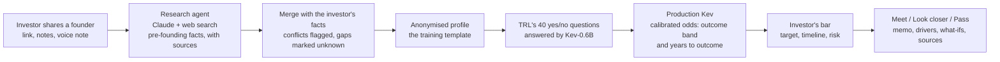

# trl-for-angels

[](https://www.youtube.com/watch?v=akMRJbdCokc)

**[▶ Watch the demo on YouTube](https://www.youtube.com/watch?v=akMRJbdCokc)**

**Halomark, a calibrated deal-screening agent for angel investors, and the research behind it.**

Angel investors usually screen founders alone, with no analysts and little time. Halomark does
the first pass for them. The investor shares a founder's LinkedIn or website, or types what
they know. A research agent looks up the founder's background as it stood on the day the company
was founded, with a source for every fact. The app turns that into an anonymised profile and asks
a set of yes/no questions about it. A small fine-tuned decision model then gives calibrated odds
of each outcome: shut down, under $50M, up to $500M, up to $1B or over $1B, and how many years it
takes. The investor's own bar (target outcome, timeline and risk appetite) turns those odds into
**Meet**, **Look closer** or **Pass**, with a memo that explains why.

Under the product is a research question about Vela Research's open-source
[Think Reason Learn (TRL)](https://github.com/Vela-Research/think-reason-learn) library. TRL
*thinks* (an LLM writes yes/no questions about founders), *reasons* (a model answers them) and
*learns* (a classical model turns the answers into a prediction). With the think and reason
steps held fixed, **which learn stage gives the most accurate and best-calibrated predictions of
founder success?** We compared TRL's own learn stages, XGBoost, and an open decision model, Kev,
before and after fine-tuning. Kev was added to TRL as a new, TRL-native learn stage, intended as
a pull request to TRL.

> **Screening aid, not investment advice.** The model is trained on a mostly generated dataset
> (3,000 founder profiles, 50 of them based on real founders), so no real-world accuracy is
> claimed.

**Results for non-researchers start at [`results/README.md`](results/README.md).**

---

## In one minute

| | What | Where |
|---|---|---|
| **Product** | Halomark: a mobile-first web app (installable on a phone). Share a founder in, watch the research run live, get a verdict with odds, drivers, what-ifs and sources. Also voice notes, push notifications and screening a whole list. | branch [`app-track`](https://github.com/Sidi3355/trl-for-angels/tree/app-track/app) |
| **Research** | 8 conditions (learn stages, plus Kev reading the raw profile) compared on the same 600 test founders, with confidence intervals and paired comparisons | [`results/`](results/README.md) |
| **Contribution to TRL** | a `combiner="decision"` learn stage that hands the final call to a decision model (Jev, or Kev on your own server), plus option descriptions for choice questions | our fork, [`Sidi3355/think-reason-learn@feature/decision-combiner`](https://github.com/Sidi3355/think-reason-learn/tree/feature/decision-combiner); PR text in [`docs/trl_pr_description.md`](docs/trl_pr_description.md) |
| **Models** | three fine-tunes of Kev-0.6B, on Hugging Face | [`kev-c3`](https://huggingface.co/Sidi3355/trl-for-angels-kev-c3), [`kev-c4`](https://huggingface.co/Sidi3355/trl-for-angels-kev-c4), [`kev-prod`](https://huggingface.co/Sidi3355/trl-for-angels-kev-prod) (the app's) |
| **Budget** | zero: free Kaggle GPUs for all model work, about $0.60 of Claude API calls for the research | [`results/METHODS.md`](results/METHODS.md#13-costs) |

## What we found

On this dataset, with Kev-0.6B answering TRL's questions (test set, 600 founders, 120 of whom
succeeded; a random pick succeeds 2 times in 10):

1. **No learn stage beat TRL's default.** The elastic net (C1a) scored 0.319 F0.5 (95% CI
   0.221–0.417): about 4 in 10 of the founders it flags succeed. Every paired difference against
   it includes zero, XGBoost and fine-tuned Kev included. The answers' signal here is additive.
2. **Fine-tuning made Kev's probabilities trustworthy.** Calibration error (ECE) fell from 0.262
   to 0.012 when Kev reads TRL's answers, the best of any condition. When fine-tuned Kev says
   30%, about 3 in 10 such founders succeed.
3. **But those probabilities are timid.** Fine-tuned Kev never gives a test founder more than
   about 0.4, so it flags few founders and finds only 10% of the successes at a
   precision-favouring threshold.
4. **TRL's questions explain more than they predict here.** Kev reading the raw profile (C4)
   matched Kev reading TRL's answers (C3). The app still uses the answers, because each verdict
   can then point to the questions that drove it.
5. **The paper's vote isn't a probability.** It ranks nearly as well as the elastic net but is
   far worse calibrated (ECE 0.251 against 0.045).
6. **A decision model must be asked exactly as it was trained.** The app's model put 35% on
   "shut down" when the options were sent without their descriptions, and 52% when sent with
   them (the real share is 50%). TRL now sends them (fork commit `d9d1380`).

| Condition | Learn stage | F0.5 (test) | ECE (test) |
|---|---|---|---|
| C1a | TRL's default: elastic net | **0.319** (0.221–0.417) | 0.045 |
| C1a-40 | elastic net on the 40 questions Kev reads | 0.306 (0.236–0.378) | 0.035 |
| C1b | the RRF paper's vote | 0.305 (0.249–0.354) | 0.251 |
| CTRL | XGBoost on the 40 answers | 0.305 (0.205–0.399) | 0.040 |
| C2 | released Kev on TRL's answers | 0.277 (0.242–0.312) | 0.262 |
| EXTRA | released Kev on the founder profile | 0.319 (0.246–0.394) | 0.465 |
| C3 | fine-tuned Kev on TRL's answers | 0.227 (0.121–0.332) | **0.012** |
| C4 | fine-tuned Kev on the founder profile | 0.282 (0.191–0.368) | 0.021 |

F0.5 weighs precision twice as much as recall (the VCBench metric); ECE is how far stated
probabilities are from observed rates (lower is better). Every threshold was tuned on val and
applied once to test. Full tables, plots and paired comparisons:
[`results/summary/d1-final/`](results/summary/d1-final/metrics.md). Plain-English findings:
[`results/FINDINGS.md`](results/FINDINGS.md). Terms: [`results/GLOSSARY.md`](results/GLOSSARY.md).

## How it works



1. **Research.** Claude, with web search and web fetch, fills every field of a fixed founder
   template (`{value, source_url, confidence}`). Only facts from before the founding date count.
   Anything later goes to the memo's notes, never to the model.
2. **Merge and anonymise.** What the investor typed or said wins. Agent findings that contradict
   it are flagged, and missing fields become "unknown". Names are removed, and the profile is
   rendered in exactly the format the model was trained on.
3. **Think and reason (TRL).** Claude wrote 93 yes/no questions from the 2,000 training founders,
   for example "Did the founder spend 5+ years at a single employer in the same industry as the
   current startup?". The best 40 are asked about every founder, and Kev-0.6B answers each with
   a probability of yes.
4. **Learn (our TRL extension).** The 40 answers become text, one line per question, and a
   fine-tuned Kev-0.6B reads them. It returns a distribution over five outcome bands and one
   over three timelines, each calibrated with its own temperature fitted on val.
5. **Act.** The investor's bar picks a probability, for example P(at least $500M within 8 years).
   A val-derived table turns each risk setting into thresholds, with the precision and recall to
   expect. What-ifs change one factor and re-score, with no new research.

Free-text notes, and anything from after the founding date, never reach the model. Nothing is
kept on the server after the session.

## The research, in brief

- **Data:** 3,000 anonymised founder profiles (template in [`shared/profile_template.md`](shared/profile_template.md)).
  50 are grounded in real founders and companies; 2,950 are generated by a seeded generator
  modelled on them, with outcomes that depend weakly on the profile plus noise. Split 2,000 train
  / 400 val / 600 test, stratified, with near-duplicates kept together.
  [`results/data/`](results/data/README.md)
- **Label:** success means an exit, IPO or funding of $500M or more (20% of founders).
- **Protocol:** every condition goes through TRL's real pipeline (`RRF.fit`, `answers`,
  `predict_proba`), on the same questions and the same cached answers. Fit on train, tune on val,
  test read once. 95% CIs come from 1,000 stratified bootstrap resamples, and pairwise
  differences are bootstrapped on the same founders.
- **Fine-tuning:** Kev's own trainer, from the released `jaredpalmer/kev-0.6b` checkpoint, lr
  2e-5, two epochs, checkpoint and temperature chosen on val, fp32 on free Kaggle T4s.
- **Records:** every decision with its evidence ([`results/DECISIONS.md`](results/DECISIONS.md)),
  every GPU run ([`results/RUNS.md`](results/RUNS.md)), and versions, seeds, timings and costs
  ([`results/run_info.json`](results/run_info.json)). The full method is in
  [`results/METHODS.md`](results/METHODS.md), and the original plan in [`MASTER_PLAN.md`](MASTER_PLAN.md).
- **Still to do:** interpretability (answer flips, probes), after the app works end to end.

## The product, in brief

Halomark is a Next.js web app (installable to a phone's home screen), with a FastAPI backend.
Its code lives on the **`app-track`** branch; see [`app/README.md` there](https://github.com/Sidi3355/trl-for-angels/blob/app-track/app/README.md).

- **Screen a founder** from a name, link or notes, or **share** a LinkedIn or website into the
  app from any other app.
- **Live progress** while the agent researches, and a **push notification** when the verdict
  is ready.
- **The memo:** the verdict and the chance, the questions that moved the score (each one tap
  from a what-if), the odds of each outcome and timeline, the founder at founding with sources,
  conflicts and unknowns, and the exact anonymised text the model read.
- **Your bar:** target outcome, timeline, risk appetite and hard filters, applied to every
  verdict instantly, each with a plain reading of what it means on the validation founders.
- **Voice notes:** record a note after a meeting. ElevenLabs transcribes it, and Claude files
  the facts that fit the template into the form. Post-founding facts stay out of the model.
- **Screen a list:** upload a CSV of up to 200 founders and watch them sort into Meet, Look
  closer and Pass.
- **Guardrails:** public information only, nothing stored after the session, and plain
  statements of what the model predicts and doesn't.

The app reads three files that this branch produces in [`shared/artifacts/`](shared/artifacts/):
the questions (`rules.json`), the production model's endpoint, request format and temperatures
(`model.json`), and the risk table (`thresholds.json`). Integration notes:
[`docs/app_integration.md`](docs/app_integration.md).

## Repository map

**Branches:** this one (`claude/determined-albattani-dl2cyy`) holds the research and the files
the app reads. `app-track` holds the app. `kaggle-results` holds every GPU run's log and outputs.

| Folder | What it holds |
|---|---|
| [`research/`](research/) | the research pipeline: dataset generation and validation, splits, RRF fit, baselines, serialisation, Kev scoring and fine-tuning, evaluation, paired comparisons, the production model's thresholds and the export of the app's files |
| [`results/`](results/README.md) | every result, written for non-researchers: findings, glossary, methods, decisions, runs, per-experiment folders with metrics, predictions, configs and plots |
| [`data/`](data/) | `raw/` the 3,000 profiles; `splits/`; `answers/` the questions and cached answer matrices; `models/` saved TRL models and the production model's temperatures; `predictions/` every condition's predictions |
| [`kaggle/`](kaggle/) | the Kaggle runner: one notebook clones this branch, runs the GPU task chosen in `run.sh`, and pushes its log and outputs to `kaggle-results` |
| [`kev_server/`](kev_server/README.md) | the Kev server the app calls: base Kev (answerer) and the production model (decider) behind one front door with a passcode, run on a PC behind a free Cloudflare tunnel |
| [`shared/`](shared/) | the contract between research and app: the profile template and the three artefacts |
| [`app/`](app/) | the app's contract (JSON Schemas) and an early snapshot of the app; the current app is on `app-track` |
| [`docs/`](docs/) | app integration notes, the TRL pull-request text, figures |
| [`tests/`](tests/) | offline tests for the research code |

## Reproduce

TRL comes from our fork, checked out next to this repo, on branch `feature/decision-combiner`
(based on upstream `3437d64`, TRL 0.3.0). Python 3.13.

```bash
git clone -b feature/decision-combiner https://github.com/Sidi3355/think-reason-learn.git ../think-reason-learn
```

```bash
uv venv --python 3.13 .venv
```

```bash
uv pip install --python .venv/bin/python -r requirements.txt
```

```bash
cp .env.example .env   # ANTHROPIC_API_KEY for question writing; KEV_BASE_URL and KEV_API_KEY for a Kev server
```

The steps, in order (each script's docstring gives its options):

| Step | Command | Needs |
|---|---|---|
| Dataset and checks | `python research/generate_dataset.py`, `python research/validate.py --profile full` | – |
| Splits | `python research/splits.py` | – |
| Questions, answers, TRL models (B1, B2) | `kaggle/run.sh` task `b1b2` | GPU (Kev), Claude key |
| Baselines (B3) | `python research/baselines.py` | – |
| Kev files (B5) | `python research/serialise.py` | – |
| Fine-tuning and scoring (C3, C4, EXTRA) | `kaggle/run.sh` task `c_kev` | GPU |
| Final evaluation (D1) | `python research/evaluate.py --stage d1-final --include-test`, `python research/paired.py --stage d1-final` | – |
| Production model (D3) | `kaggle/run.sh` task `d_prod`, then `python research/prod_report.py --stage d3-val` | GPU |
| Risk table and app files (D4) | `python research/thresholds.py --stage d4-final`, `python research/export_artifacts.py --prod-input c3 ...` | – |
| Tests | `python -m pytest -q tests` (here); `poetry run pytest -q` (in the fork) | – |

GPU steps run on Kaggle's free T4s: set `TASK` in `kaggle/run.sh`, push, and run the
`kaggle/runner.ipynb` notebook. Results come back on the `kaggle-results` branch, and
`python kaggle/import_run.py runs/<run id>` copies them into `data/`. Every expensive output (TRL's
questions and answers, model predictions) is cached and committed, so the evaluation reruns
without a GPU or any API key.

## Models, data and services used

| What | Used for |
|---|---|
| [TRL](https://github.com/Vela-Research/think-reason-learn) (Vela Research, v0.3.0), via [our fork](https://github.com/Sidi3355/think-reason-learn/tree/feature/decision-combiner) | the think, reason and learn pipeline; every model call |
| Claude Opus 5.5 (Anthropic API) | TRL's question writer; the app's research agent (web search, web fetch); sorting voice notes into the form |
| [Kev](https://github.com/jaredpalmer/kev) (Apache-2.0) and `jaredpalmer/kev-0.6b` on `Qwen/Qwen3-0.6B-Base` | TRL's answerer (base); the learn stage and the app's decider (fine-tuned) |
| ElevenLabs Speech-to-Text (Scribe) | voice notes |
| scikit-learn, XGBoost, PyTorch, matplotlib | baselines, metrics, plots |
| Kaggle (free T4 GPUs), Hugging Face Hub, Vercel, Railway, Cloudflare Tunnel | compute, model hosting, the app's frontend and backend, the Kev server's address |

## Limits

- **Mostly generated data.** Results describe this dataset, not real founders. VCBench is the
  intended real test.
- **Kev-0.6B, not Jev, answers the questions** (Jev has no free tier), so the baselines are TRL
  with an open 0.6B answerer, not TRL as Vela runs it.
- **Small numbers.** 120 successful founders in test and 80 in val, hence the wide intervals.
- **Free compute.** fp32 on T4s, two epochs per fine-tune at most.

## Licence and credits

Code in this repository: MIT ([`LICENSE`](LICENSE)). TRL is Vela Research's; Kev is Jared Palmer's
(Apache-2.0); Qwen3-0.6B-Base is Alibaba Cloud's Qwen team's (Apache-2.0). Built for the
Autonomous Agents track of a hackathon, with Claude Code.
