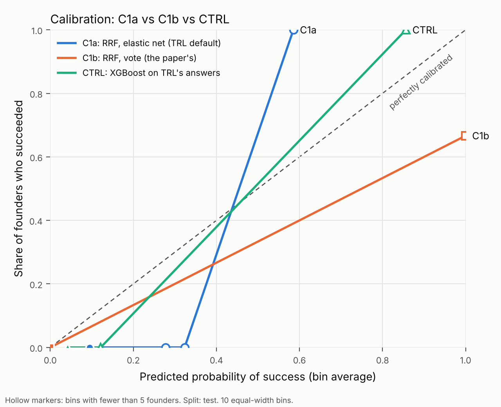

# Example figures (synthetic data, not results)

These show what `research/evaluate.py` draws. They come from a pipeline test on 60 made-up
founders with a scripted question writer, so their numbers mean nothing. Real results live
in `results/summary/<stage>/plots/` once the experiments run.

## `example_reliability_synthetic.png`

A reliability diagram (calibration plot). Each line is one condition: C1a (TRL's elastic net),
C1b (the paper's vote) and CTRL (XGBoost). The horizontal axis is the probability a model gave
(averaged within each of 10 bins), and the vertical axis is the share of those founders who
actually succeeded. A well-calibrated model sits on the dashed diagonal: when it says 70%,
about 70% succeed. Hollow markers are bins with fewer than 5 founders. Each condition keeps
the same colour and marker shape in every plot.

